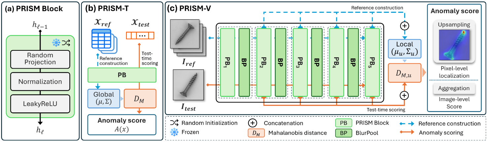
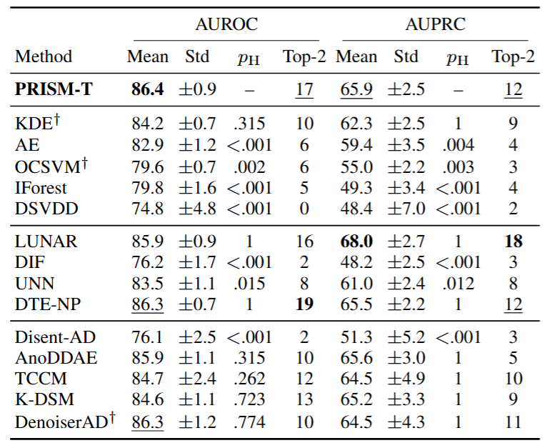

# How Far Can Anomaly Detection Go Before Learning? Random Neural Features from Tables to Pixels

**PRISM FrameWork**



Authors: *Hyojun Yi, Geunyoung Kim, Hogeon Seo, and Seunghyoung Ryu*

paper: How Far Can Anomaly Detection Go Before Learning? Random Neural Features from Tables to Pixels


## Introduction

This repository contains the implementation of **PRISM-T**, the tabular anomaly detection module of PRISM. PRISM-T investigates how effectively a neural network with randomly initialized weights can detect anomalies in tabular data.


## Data

Download and prepare the dataset as follows.

### ADBench

Download the 47 Classical datasets from [ADBench](https://github.com/Minqi824/ADBench) by running:

```bash
python datasets/download_data.py
```

After preparation, the datasets will be available at:

```text
data/
└── Classical/
```


## Running the experiments

None of the drivers below download or convert anything,
so `data/Classical` must already exist; a missing data
root aborts before any computation starts.


```bash
python scripts/run_prism_t.py
```
## Results



Comparison of tabular anomaly detection performance on 47 ADBench datasets in terms of AUROC and AUPRC (%, mean ± standard deviation over five random seeds). PRISM-T achieves the highest mean AUROC and the second-highest mean AUPRC among the compared methods. The table also reports Holm-adjusted p-values (p_H) and the number of datasets on which each method ranks among the top two (Top-2).

## Project structure

```
models/      prism_t.py (the PRISM-T encoder), mahalanobis.py
             (shrinkage Mahalanobis fit/score)
evaluation/  metrics.py (AUROC/AUPRC)
datasets/    loader.py (semi-supervised split + StandardScaler);
             download_data.py fetches the 47 ADBench Classical
             datasets into the layout it reads
scripts/     run_prism_t.py (the single experiment engine; defaults = the
             adopted main config)
data/        create it — datasets are not distributed
results/     created by the run script
```


## Acknowledgements

This work was partially supported in part by the IITP (Institute of Information & Communications Technology Planning & Evaluation) - ICAN (ICT Challenge and Advanced Network of HRD) grant funded by the Korea government (Ministry of Science and ICT) (IITP-2026-RS-2024-00436528), and in part by the National Research Foundation of Korea(NRF) grant funded by the Korea government(MSIT) (RS-2024-00454514)


## License and Citation

This repository is made publicly available for non-commercial academic research and reproducibility purposes. The source code may be downloaded, executed, and modified for such purposes. Commercial use and redistribution require prior written permission from the rights holder.
The underlying technology is subject to a pending patent application. No patent license is granted under this notice.

The 47 ADBench "Classical" datasets are not redistributed with this repository. Instead, the provided download script retrieves them directly from the [official ADBench repository](https://github.com/Minqi824/ADBench). The datasets remain subject to their respective licensing terms.

Citation information will be added upon publication.
